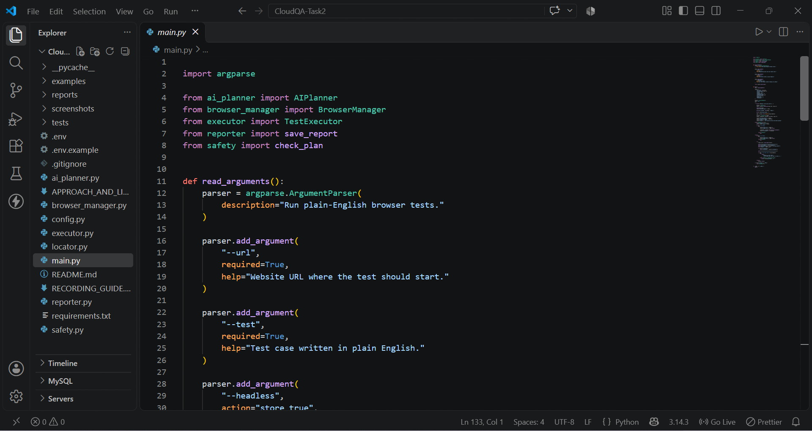
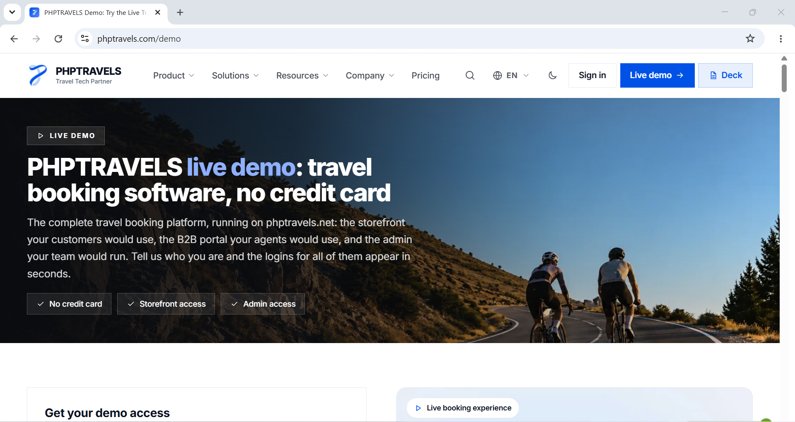
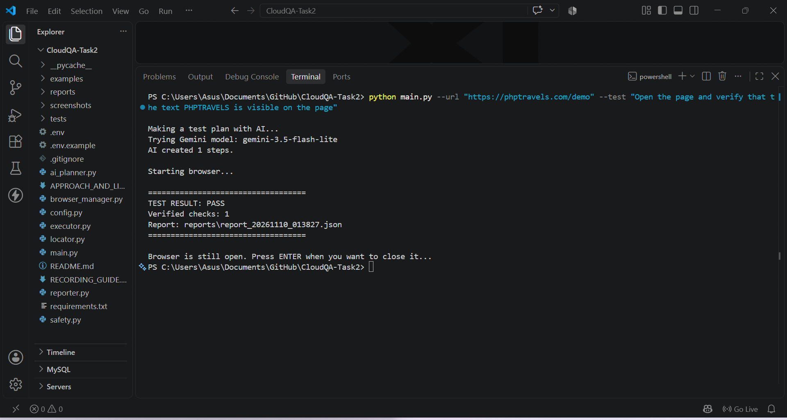
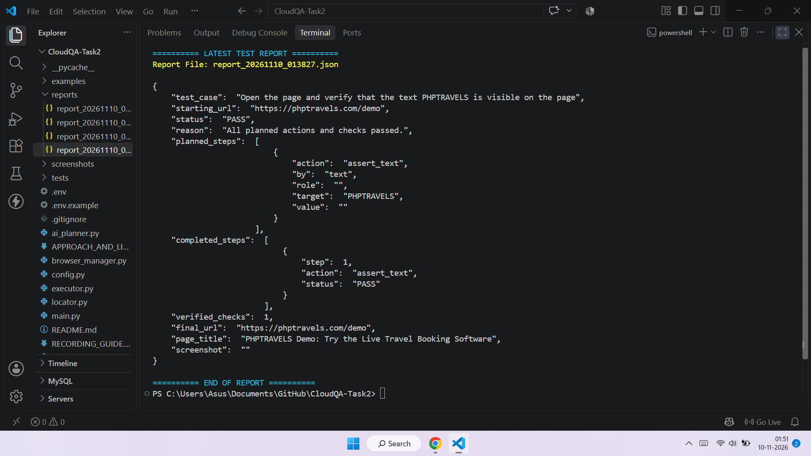
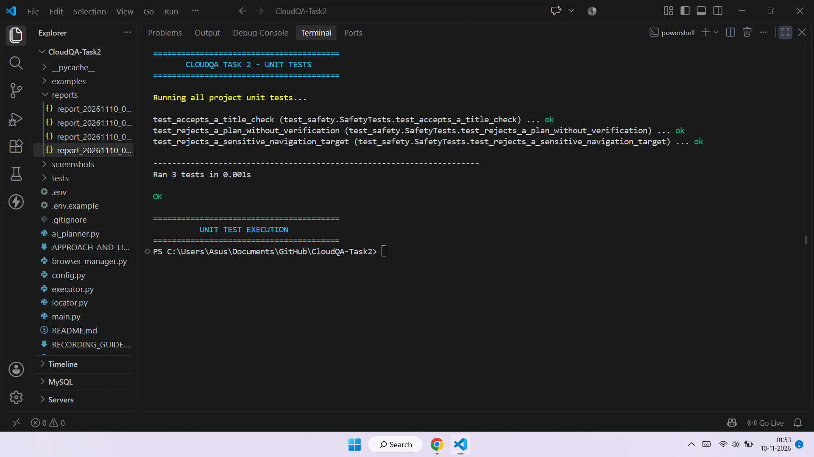

# CloudQA Task 2 - Plain-English Browser Test Runner

## Project Overview

CloudQA Task 2 is a Python-based browser testing tool that converts plain-English test cases into automated browser actions using Google Gemini AI and Playwright.

The user provides a website URL and a test instruction in normal English. The AI creates a test plan, Playwright performs the planned actions in a Chromium browser, and the program reports whether the test passed or failed.

The tool is designed to accept different website URLs and test instructions instead of being limited to one fixed website.

## Features

- Accepts test cases written in plain English.
- Uses Google Gemini AI to create structured test steps.
- Uses Playwright to automate a Chromium browser.
- Supports browser actions and verification checks.
- Reports PASS or FAIL in the terminal.
- Saves test results as JSON reports.
- Saves a screenshot when a browser test fails.
- Includes basic safety checks for unsupported or sensitive actions.
- Supports visible browser execution and headless execution.
- Keeps the visible browser open until the user presses ENTER after the test.

## Technology Used

| Technology | Purpose |
|---|---|
| Python | Main programming language |
| Google Gemini API | Converts English instructions into test steps |
| Playwright | Browser automation |
| Chromium | Browser used for testing |
| JSON | Stores test reports |
| unittest | Tests the basic safety checks |

## Project Structure

```text
CloudQA-Task2/
│
├── main.py
├── config.py
├── ai_planner.py
├── browser_manager.py
├── locator.py
├── executor.py
├── safety.py
├── reporter.py
│
├── tests/
│   └── test_safety.py
│
├── examples/
│   └── test_cases.txt
│
├── reports/
├── screenshots/
│
├── requirements.txt
├── .gitignore
├── README.md
├── APPROACH_AND_LIMITATIONS.md
└── RECORDING_GUIDE.md
```

## Requirements

- Python 3.10 or newer
- Internet connection
- Google Gemini API key
- Chromium browser installed through Playwright
- Windows, macOS, or Linux

Visual Studio Code is recommended.

## Setup Instructions

### 1. Open the project

Open the `CloudQA-Task2` folder in Visual Studio Code.

Open the VS Code terminal.

### 2. Create a virtual environment

```powershell
python -m venv .venv
```

Activate it on Windows:

```powershell
.venv\Scripts\Activate.ps1
```

If PowerShell blocks activation, use `.venv\Scripts\python.exe` instead of `python` in the following commands.

### 3. Install dependencies

```powershell
python -m pip install -r requirements.txt
```

### 4. Install Chromium

```powershell
python -m playwright install chromium
```

### 5. Configure the Gemini API key

Create a file named .env in the project folder.

Add your Gemini API key and model settings:

GEMINI_API_KEY=your_real_api_key_here
GEMINI_MODEL=gemini-3.5-flash-lite
GEMINI_FALLBACK_MODELS=gemini-3.7-flash,gemini-3.8-flash
```

The model names must be available to your Gemini API account. Change them if needed.

**Important:** Never upload the `.env` file or expose your API key on GitHub.

## How to Run

The program accepts two required command-line arguments:

- `--url`: The website URL to test.
- `--test`: The test case written in plain English.

### Example 1: PHPTravels title verification

```powershell
python main.py --url "https://phptravels.com/demo" --test "Open the page and verify that the page title contains PHPTRAVELS"
```

### Example 2: Visible text verification

```powershell
python main.py --url "https://phptravels.com/demo" --test "Open the page and verify that the text PHPTRAVELS is visible on the page"
```

### Example 3: Another website

```powershell
python main.py --url "https://example.com" --test "Open the page and verify that the page title contains Example Domain"
```

These are example commands. The result depends on the website content, AI-generated plan, and available browser elements.

### Run in headless mode

To run the browser without showing its window, add `--headless`:

```powershell
python main.py --url "https://example.com" --test "Verify that the page title contains Example Domain" --headless
```

## How the Tool Works

1. The user enters a website URL and a plain-English test case.
2. The AI planner sends the instruction to Google Gemini.
3. Gemini generates structured browser test steps.
4. The safety module checks whether the generated plan contains supported actions.
5. Playwright opens the Chromium browser and visits the website.
6. The test executor performs the planned browser actions and verification checks.
7. The reporter saves the result in a JSON file.
8. The terminal displays the final PASS or FAIL result.

## Test Results

The program provides:

- **PASS:** All planned actions finish successfully and the required verification checks pass.
- **FAIL:** An action or verification fails, or the test cannot be completed.

A JSON report is saved inside the `reports` folder.

The report contains information such as:

- Original test case
- Starting URL
- Final test status
- AI-generated test steps
- Completed steps
- Number of verified checks
- Final page URL
- Page title
- Failure screenshot path, when available

A screenshot is saved in the `screenshots` folder when a browser test fails.

For visible browser execution, the browser remains open after the result is printed. Press ENTER in the terminal to close it.

## Running Unit Tests

Run the local unit tests using:

```powershell
python -m unittest discover -s tests -v
```

These tests check the basic safety rules of the project.

They do not call Gemini or perform live browser testing.

## Approach

The project uses a modular design so that each part has a separate responsibility.

- The AI planner converts plain-English instructions into structured steps.
- The browser manager controls the Chromium browser.
- The locator module finds the required page elements.
- The executor performs actions and verification checks.
- The safety module checks generated plans.
- The reporter saves the final test results.

The website URL and test instruction are provided at runtime. This avoids writing the PHPTravels website address or a single fixed test case directly into the automation logic.

## Limitations

- AI may misunderstand unclear test instructions or generate an incorrect test plan.
- Gemini API availability, rate limits, quotas, and network errors can affect execution.
- Website layouts, text, and element labels can change.
- Some websites require login details, OTP, CAPTCHA, or special access.
- The locator module may stop when it cannot identify a unique matching element.
- The safety checks cover common cases but are not a complete security system.
- Not every test case or website is guaranteed to work without changes.
- The generated test plan and report should be reviewed when a result is unexpected.

For additional details, see [APPROACH_AND_LIMITATIONS.md](APPROACH_AND_LIMITATIONS.md).

## Screenshots

### 1. Project Structure

Shows the main Python files, test folder, and project organization.



### 2. Live Browser Execution

Shows the actual website open in Chromium during browser automation.



### 3. Test Execution Result

Shows the command-line test input and the actual PASS or FAIL result.



### 4. Generated JSON Report

Shows the JSON report created after a real test execution.



### 5. Unit Test Results

Shows the output of the local unit tests.



## Submission

This repository contains the source code, setup instructions, usage examples, approach, limitations, and test evidence for CloudQA Task 2.

A separate screen recording demonstrates the project running and explains its working process.